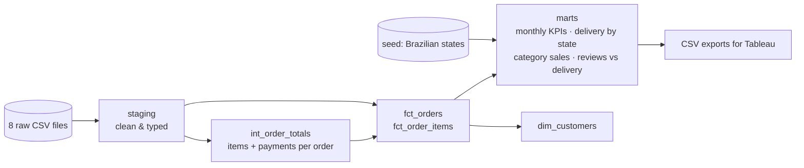
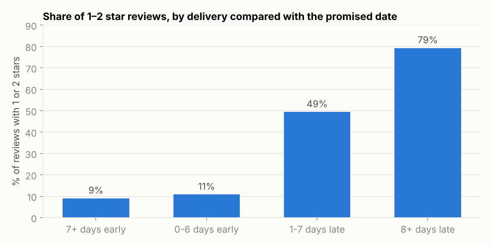

# E-commerce analytics with dbt – Olist

Olist is a Brazilian marketplace that connects small shops to large online stores. It published a sample of its real database: about 100,000 orders placed between 2016 and 2018, spread over eight raw tables (orders, items, payments, reviews, customers, products, sellers, categories).

The tables come straight from the transactional system, so they are not ready for analysis: types are wrong, some reviews are duplicated, the same customer appears under several IDs, and a few records contradict each other. I used **dbt** and **DuckDB** to turn them into clean, tested tables that an analyst or a dashboard can use directly. The Tableau dashboard built on top of these tables is in a separate repository: [olist-tableau-dashboard](https://github.com/RahmaYEZZA/olist-tableau-dashboard).

**Tools:** dbt, DuckDB, SQL, Python

## How the models are organised



- **staging/**: one model per source table. I rename columns, cast types, translate product categories from Portuguese to English, and keep a single review per order.
- **intermediate/**: `int_order_totals` adds up items and payments for each order.
- **seeds/**: Brazilian state names and regions, so that Tableau can draw maps and group states.
- **marts/**: `fct_orders` (one row per order with value, delivery times, lateness and review score), `fct_order_items`, `dim_customers`, and four small tables built for reporting.

Two modelling choices that changed the numbers:
- `customer_id` is created for every order, so counting it would say Olist has almost 100,000 customers. The real person is `customer_unique_id`: 94,990 customers with a valid purchase, and **only 3% of them ever came back** for a second order.
- An order is counted as a sale only if it was not canceled or unavailable (`is_valid_sale`).

## Data quality

`dbt build` runs 37 tests as it builds the models: uniqueness and non-null keys, relationships between tables, accepted values, and five custom tests in [`tests/`](tests/). Errors that should never happen stop the build. Known problems in the source are set to `warn`, so they stay visible without blocking everything:

| Check | Result | What I did |
|-------|--------|------------|
| A review per order | 99,224 reviews for 98,673 orders, some `review_id` repeated | kept the latest review for each order |
| Delivered after purchase | 0 errors | blocking test |
| Handed to the carrier after purchase | 166 orders shipped "before" being bought | warning, timestamps kept as they are |
| Delivered orders have a delivery date | 8 orders without one | warning, excluded from delivery-time metrics |
| Payment = items + freight | 1,084 orders differ by more than 1 BRL | warning: 772 are canceled or unavailable orders that were paid but have no items; the rest are vouchers and instalment interest |
| Every order has a payment | 1 order without payment | warning |
| Known payment types | `not_defined` appears 3 times | warning |
| Product category | 610 products without a category | grouped as `unknown` |

## What the data shows

Over the period, valid orders represent about **15.7 million BRL** (98,207 orders, 160 BRL on average).



**Late deliveries destroy customer satisfaction.** When an order arrives before the promised date, 9 to 11% of reviews are negative (1 or 2 stars). When it is more than a week late, that goes up to 79%, and the average score falls from 4.3 to 1.7.

**Olist promises long delivery times and usually beats them.** Orders arrive in 12.5 days on average, while the date shown to the customer is 24 days away. That buffer is why only 8% of orders are late overall. When the buffer is not enough, as in February–March 2018 (16% and 21% of orders late), the average review drops to 3.8.

**Distance matters.** São Paulo customers receive their orders in under 9 days. In the North and Northeast it takes 20 to 23 days on average (and the Northeast has the most late orders, 14%), and freight represents up to a third of the order value. Rio de Janeiro is an exception worth looking at: it is next to São Paulo, where 60% of sellers are based, yet 13.5% of its orders arrive late.

**Customers rarely come back.** With 97% of customers ordering only once, growth relies on acquisition. Better delivery reliability is probably the cheapest way to change that.

## Run it

```bash
pip install -r requirements.txt
python scripts/download_data.py          # raw CSV files into data/raw/
dbt build --profiles-dir .               # builds the models and runs the tests
python scripts/export_for_tableau.py     # marts as CSV in exports/
```

`dbt docs generate --profiles-dir . && dbt docs serve --profiles-dir .` opens the documentation and the lineage graph in the browser.

**Data:** [Olist public dataset](https://github.com/olist/work-at-olist-data), shared by Olist for analysis and learning.
